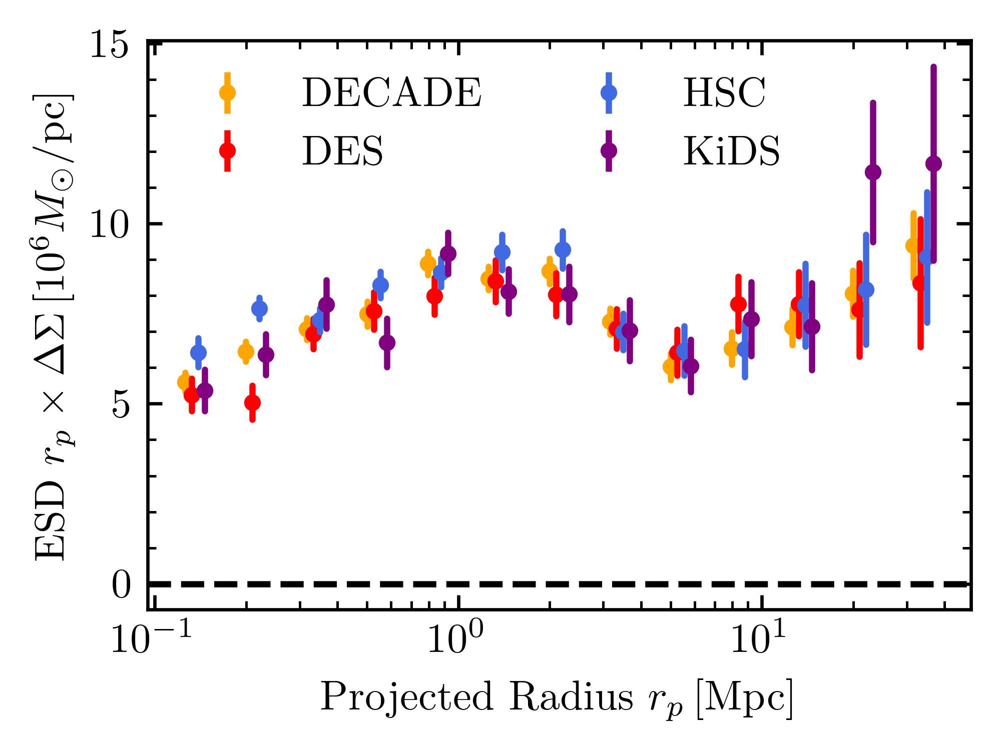

<div align="center">


[](https://github.com/johannesulf/dsigma/actions)
[](https://dsigma.readthedocs.io/en/latest/)
[](https://coveralls.io/github/johannesulf/dsigma?branch=main)


[](https://raw.githubusercontent.com/johannesulf/dsigma/main/LICENSE)
[](https://doi.org/10.5281/zenodo.20378642)

</div>

``dsigma`` is an easy-to-use Python package for measuring gravitational galaxy-galaxy lensing. Using a lensing catalog, it estimates excess surface density around a population of lenses, such as galaxies in the Sloan Digital Sky Survey or the Baryon Oscillation Spectroscopic Survey. It has a flexible API and can utilize data from, DECADE, the Dark Energy Survey (DES), the Kilo-Degree Survey (KiDS), and the Hyper Suprime-Cam (HSC) lensing surveys, among others. With core computations written in C, ``dsigma`` is very fast. Additionally, ``dsigma`` provides out-of-the-box support for estimating covariances with jackknife resampling and calculating various summary statistics.

## Example

This example code demonstrates the basic usage of ``dsigma``. Here, we measure the galaxy-galaxy lensing amplitude around 100,000 lenses using 10 million source galaxies.

```python
import numpy as np
from astropy import units as u
from astropy.table import Table
from dsigma.precompute import precompute
from dsigma.jackknife import compute_jackknife_fields, jackknife_resampling
from dsigma.stacking import excess_surface_density

n_l = 100_000
rng = np.random.default_rng(0)
table_l = Table(dict(
    ra=rng.uniform(0, 360, n_l),
    dec=np.rad2deg(np.arcsin(rng.uniform(-1, 1, n_l))),
    z=np.full(n_l, 0.3), w_sys=np.ones(n_l)))


n_s = 10_000_000
sigma_e = 0.26
table_s = Table(dict(
    ra=rng.uniform(0, 360, n_s),
    dec=np.rad2deg(np.arcsin(rng.uniform(-1, 1, n_s))),
    z=np.full(n_s, 0.7), w=np.ones(n_s), e_1=rng.normal(0, sigma_e, n_s),
    e_2=rng.normal(0, sigma_e, n_s)))

rp_bins = np.geomspace(0.1, 10, 11) * u.Mpc
precompute(table_l, table_s, rp_bins, progress_bar=True)
result = excess_surface_density(table_l, return_table=True)
compute_jackknife_fields(table_l, 100, seed=0)
ds_cov = jackknife_resampling(excess_surface_density, table_l)
result['ds_err'] = np.sqrt(np.diag(ds_cov))

result.keep_columns(['rp_min', 'rp_max', 'ds', 'ds_err'])
for key in result.colnames:
    result[key].info.format = '.3e'

print(result)
```

```
  rp_min    rp_max            ds                  ds_err       
   Mpc       Mpc    littleh solMass / pc2 littleh solMass / pc2
--------- --------- --------------------- ---------------------
1.000e-01 1.585e-01             3.613e+01             1.981e+01
1.585e-01 2.512e-01            -1.153e+01             1.394e+01
2.512e-01 3.981e-01             1.236e-01             8.948e+00
3.981e-01 6.310e-01            -2.513e+00             5.448e+00
6.310e-01 1.000e+00             3.046e+00             3.862e+00
1.000e+00 1.585e+00             1.094e+00             1.989e+00
1.585e+00 2.512e+00             4.080e-01             1.555e+00
2.512e+00 3.981e+00            -2.152e-02             8.493e-01
3.981e+00 6.310e+00            -4.896e-01             5.198e-01
6.310e+00 1.000e+01             2.721e-01             3.673e-01
```

In the above toy example, we do not expect any intrinsic signal. However, the plot below shows results from ``dsigma`` on real lensing data.



``dsigma`` focuses specifically on computing the excess surface density $\Delta\Sigma$ around a set of lens galaxies as a function of projected physical separation. In principle, the more general ``TreeCorr`` package can also be used to compute various two-point correlation functions, including galaxy-galaxy lensing. However, for galaxy-galaxy lensing, ``TreeCorr`` computes the tangential shear $\gamma_t$, not $\Delta\Sigma$. Furthermore, ``TreeCorr`` has a steeper learning curve and requires more care in implementing survey-specific correction terms.

## Authors

* Johannes U. Lange
* Song Huang
* Alexie Leauthaud

## Installation

The easiest way to install ``dsigma`` is to use ``pip`` for the latest stable version from the Python Package Index (PyPI).

    pip install dsigma

Alternatively, you can install the latest development version from GitHub.

    pip install git+https://github.com/johannesulf/dsigma

## Documentation

Documentation for ``dsigma`` with concept introductions, examples, and API documentation is available on [readthedocs](https://dsigma.readthedocs.io/).

## Attribution

``dsigma`` is listed in the [Astronomy Source Code Library](https://ascl.net/2204.006). If you find the code useful in your research, please cite [Lange & Huang (2022)](https://ui.adsabs.harvard.edu/abs/2022ascl.soft04006L/abstract).

## License

``dsigma`` is licensed under the MIT License.

## Generative AI

Generative AI was used to search for potential bugs in the code and to improve the documentation by finding typos and suggesting minor rewrites. The core developers did not use AI to write any part of the ``dsigma`` code itself. Code contributions from other developers may use AI, as described in the respective pull requests, and are carefully vetted by the core developers.
