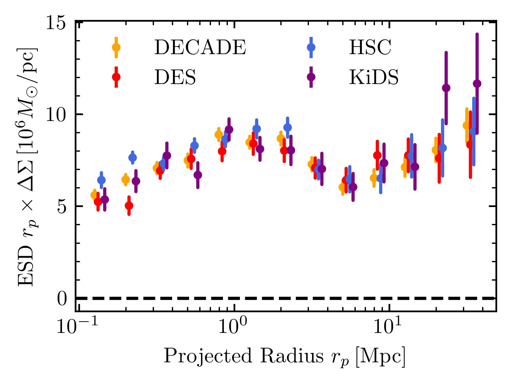

Overview
========

:code:`dsigma` is an easy-to-use Python package for measuring gravitational galaxy-galaxy lensing. Using a lensing catalog, it estimates excess surface density around a population of lenses, such as galaxies in the Sloan Digital Sky Survey or the Baryon Oscillation Spectroscopic Survey. It has a flexible API and can utilize data from, DECADE, the Dark Energy Survey (DES), the Kilo-Degree Survey (KiDS), and the Hyper Suprime-Cam (HSC) lensing surveys, among others. With core computations written in C, :code:`dsigma` is very fast. Additionally, :code:`dsigma` provides out-of-the-box support for estimating covariances with jackknife resampling and calculating various summary statistics.

The example below shows the basic usage of :code:`dsigma`. It measures the galaxy-galaxy lensing signal around 100,000 lens galaxies using 10 million source galaxies.

.. code-block:: python

    import numpy as np
    from astropy import units as u
    from astropy.table import Table
    from dsigma.precompute import precompute
    from dsigma.jackknife import compute_jackknife_fields, jackknife_resampling
    from dsigma.stacking import excess_surface_density

    n_l = 100_000
    rng = np.random.default_rng(0)
    table_l = Table(dict(
        ra=rng.uniform(0, 360, n_l),
        dec=np.rad2deg(np.arcsin(rng.uniform(-1, 1, n_l))),
        z=np.full(n_l, 0.3), w_sys=np.ones(n_l)))

    n_s = 10_000_000
    sigma_e = 0.26
    table_s = Table(dict(
        ra=rng.uniform(0, 360, n_s),
        dec=np.rad2deg(np.arcsin(rng.uniform(-1, 1, n_s))),
        z=np.full(n_s, 0.7), w=np.ones(n_s), e_1=rng.normal(0, sigma_e, n_s),
        e_2=rng.normal(0, sigma_e, n_s)))

    rp_bins = np.geomspace(0.1, 10, 11) * u.Mpc
    precompute(table_l, table_s, rp_bins, progress_bar=True)
    result = excess_surface_density(table_l, return_table=True)
    compute_jackknife_fields(table_l, 100, seed=0)
    ds_cov = jackknife_resampling(excess_surface_density, table_l)
    result['ds_err'] = np.sqrt(np.diag(ds_cov))

    result.keep_columns(['rp_min', 'rp_max', 'ds', 'ds_err'])
    for key in result.colnames:
        result[key].info.format = '.3e'

    print(result)

.. code-block:: console

      rp_min    rp_max            ds                  ds_err
       Mpc       Mpc    littleh solMass / pc2 littleh solMass / pc2
    --------- --------- --------------------- ---------------------
    1.000e-01 1.585e-01             3.613e+01             1.981e+01
    1.585e-01 2.512e-01            -1.153e+01             1.394e+01
    2.512e-01 3.981e-01             1.236e-01             8.948e+00
    3.981e-01 6.310e-01            -2.513e+00             5.448e+00
    6.310e-01 1.000e+00             3.046e+00             3.862e+00
    1.000e+00 1.585e+00             1.094e+00             1.989e+00
    1.585e+00 2.512e+00             4.080e-01             1.555e+00
    2.512e+00 3.981e+00            -2.152e-02             8.493e-01
    3.981e+00 6.310e+00            -4.896e-01             5.198e-01
    6.310e+00 1.000e+01             2.721e-01             3.673e-01

The lenses and sources in this toy example have random positions and shapes, so the expected signal is zero. For a measurement on real lensing data, see the plot below.

   Galaxy-galaxy lensing amplitude around galaxies in the BOSS LOWZ sample calculated with :code:`dsigma`.

.. toctree::
    :caption: Getting Started
    :maxdepth: 1
    :hidden:

    start/installation
    start/quickstart
    start/background

.. toctree::
    :caption: Workflow
    :maxdepth: 1
    :hidden:

    workflow/preparation
    workflow/precomputation
    workflow/stacking
    workflow/resampling
    workflow/magnification

.. toctree::
    :caption: Applications
    :maxdepth: 1
    :hidden:

    applications/intro
    applications/decade
    applications/des_y3
    applications/hsc_y3
    applications/kids_legacy

.. toctree::
    :caption: API Documentation
    :maxdepth: 1
    :hidden:

    api/helpers
    api/jackknife
    api/physics
    api/precompute
    api/scripts
    api/stacking

Authors
-------

* Johannes Lange
* Song Huang
* Alexie Leauthaud

Documentation was edited with the assistance of Claude Sonnet 4.6.

Attribution
-----------

:code:`dsigma` is listed in the `Astronomy Source Code Library <https://ascl.net/2204.006>`_. If you find the code useful in your research, please cite `Lange & Huang (2022) <https://ui.adsabs.harvard.edu/abs/2022ascl.soft04006L/abstract>`_.

License
-------

:code:`dsigma` is licensed under the MIT License.
